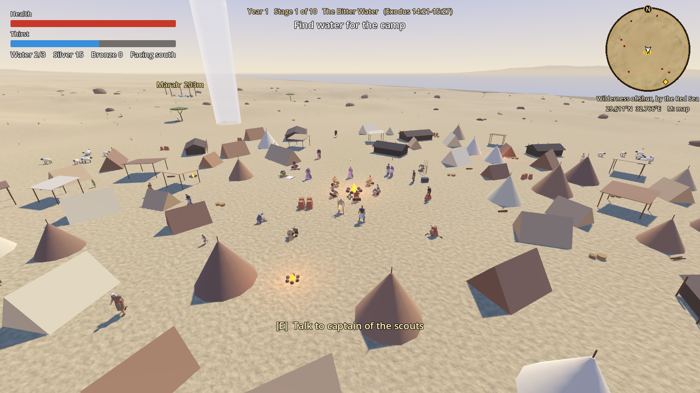
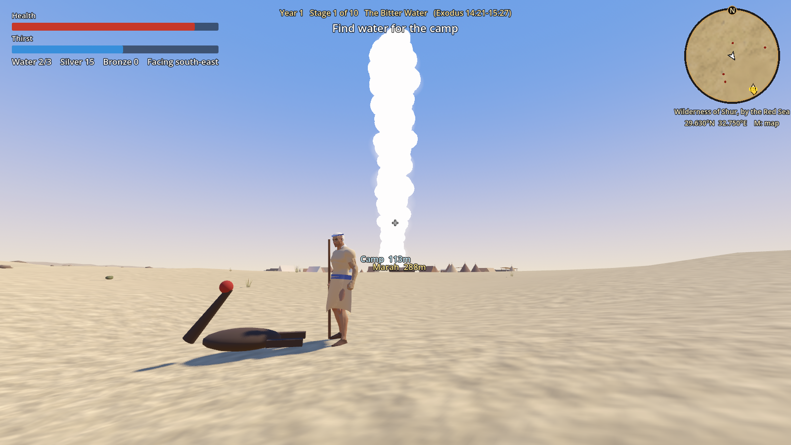

# In the Wilderness

A third-person 3D action RPG about Israel's forty years in the wilderness, from the Red Sea to
the Jordan (Exodus 15 to Deuteronomy 34). You play a young Israelite scout who keeps the camp
alive: finding water, running errands for the people, driving off raiders and following the
pillar of cloud from stage to stage.

Built with Godot 4.7 and GDScript. The people are modelled, rigged low-poly characters from
Quaternius' free CC0 kits, dressed in tunics, robes and headcloths that the game generates to
fit them. Each stage's land is shaped from a model of the real region, so the sea and the
mountains stand where they do at that camp, and it is strewn with rocks, dry grass, bushes and
acacias. The camp is a close-packed spread of tents where men, women and children walk about,
sit by the fire and work, and will tell you what is on their minds; from Sinai onward the
tabernacle stands at its centre. A round map in the corner shows your surroundings and
position, and M opens a map of the whole journey. Everything needed is in the repository, so a
fresh clone is ready to run.

**Status:** playable prototype. No sound, and the numbers are not yet balanced.

A new journey starts in the character creator: sex, skin, face shape, eyes, brows, hair,
beard, head covering, clothing and colors.



## Set up a new PC

You need Git and **Godot 4.7.x, standard build** (not the .NET build). Any GPU that supports
Vulkan, Direct3D 12 or Metal is enough.

1. Install Godot and make sure `godot --version` prints `4.7.x`.

   | System | Install |
   |---|---|
   | Windows | `winget install GodotEngine.GodotEngine`, then open a new terminal. This adds `godot` (window) and `godot_console` (prints to the terminal). |
   | macOS | `brew install --cask godot` |
   | Linux | `flatpak install flathub org.godotengine.Godot`, or your distribution's package |
   | Any | Download from <https://godotengine.org/download> and put the executable on your PATH as `godot`. |

   Package managers can lag behind or run ahead. If the version is not 4.7.x, use the download page.

2. Clone and enter the project.

   ```bash
   git clone https://github.com/TurkishP/in_the_wilderness.git
   cd in_the_wilderness
   ```

3. Build the import cache once. This creates the untracked `.godot/` folder and converts the
   character models, so it can take a minute.

   ```bash
   godot --headless --path . --import
   ```

4. Confirm the setup with the self-test. On Windows use `godot_console` so the output is visible.

   ```bash
   godot --headless --path . -- --selftest
   ```

   It must print `SELFTEST OK  (0 failed)`. Read the output rather than the exit code: a script
   error stops the test early and Godot still exits with 0.

5. Play.

   ```bash
   godot --path .
   ```

   On Windows you can also double-click `play.cmd`.

## Everyday commands

| Task | Command |
|---|---|
| Play | `godot --path .` |
| Open in the Godot editor | `godot --path . --editor` |
| Self-test (no window) | `godot --headless --path . -- --selftest` |
| Start at stage N with a throwaway save | `godot --path . -- --stage=N` |
| Save a screenshot and exit | `godot --path . --resolution 1600x900 -- --stage=2 --auto --shot=/full/path/out.png` |

Everything after the bare `--` is a debug argument of the game. The full list is at the top of
[scripts/world.gd](scripts/world.gd): teleporting to the objective, starting a raid, opening a
menu (`--menu=gear|trade|smith|chest|lid|pause|scout|saves|how|settings`), equipping gear (`--equip=bronze_spear,hide_shield`),
holding the sling or bow for a screenshot (`--aim=sling|bow`), stopping in the middle of a blow
(`--blow=3 --view=115`), skipping objectives.

The music is made by [tools/make_music.py](tools/make_music.py) and the wind sounds by
[tools/make_sounds.py](tools/make_sounds.py) (both need Python with numpy, and ffmpeg); the
short sound effects by [tools/make_effects.py](tools/make_effects.py) (numpy only). Run them
again only to change the sounds; the `.ogg` and `.wav` files they write are committed. After
adding sound files, run `godot --headless --path . --import` once.

Run the self-test after every change, and take a screenshot after any visual change.

## Controls

| Key | Action |
|---|---|
| W A S D | Move |
| Mouse | Look |
| Shift | Sprint (costs thirst and stamina; walk to get your breath back) |
| Space | Jump. Rocks, tents and trees are solid: walking into a low stone steps onto it, and jumping against something whose top is within reach scrambles up onto it |
| Left mouse | Strike. Press again during a blow for the next one, up to three; each kind of weapon has its own three blows (see Weapons below), and a staff has a single thrust with its butt. With a blade in each hand the second blow is the left hand's. Heavier weapons swing more slowly. In the air the first blow is a jump attack, brought down from overhead. With a bow: hold to draw, release to shoot |
| Right mouse | Hold to whirl the sling, release to throw. While it goes round, a dotted arc and a ring show where the stone will land (red on an enemy). Each throw uses up a stone |
| R | Put both hands' gear away (staff, spear, bow and shield on the back, blades at the belt) or take it up. Attacking takes it up by itself |
| E | Talk or use |
| Q | Drink from the waterskin |
| I (or Tab) | Inventory: the bag on the left, what you wear and wield on the right |
| M | Map of the journey |
| Esc | The menu: The Journey, The Scout (level and stats), How to Play, Saved Journeys, Settings; and to change how you look, begin again or quit |

The game opens on a title screen: Mount Sinai seen from the plain in the evening, with the camp
below it and the cloud on its top. From there, start a new journey, continue the latest save
(the line under it says which stage it is at) or open the list of saves and pick an earlier one;
settings and quit are there too.

Each stage begins with its introduction as a dialog, once. It can be read again at any time in
the menu under The Journey, which also shows what lies ahead and lets you page back through the
stages already travelled.

### Carrying, water and saving

- **Bag:** a grid of places, and bigger things take more of them: a dagger 1x2, a sword 1x3, a
  spear or staff 1x4, a shield 2x2 or 2x3, a robe 2x4. Sling stones stack five to a place and
  arrows twenty. The bag has three levels, shown at the top of the inventory: the shoulder bag
  carried from the start is 8x5 (40 places), and the trader sells a traveller's pack (10x5) and
  a caravan pack (10x6), and stones and arrows by the handful. Stones are also gathered with E from stony
  patches out in the wilderness. Gear lying on the ground stays there while the bag has no room.
- **Inventory (I):** click an item to pick it up and click again to put it down, on a free place,
  on another item to swap them, or on a slot to wear it. Right-click equips, or takes off into
  the bag. Hovering shows what an item does. Slots: head, neck, right hand, left hand, upper
  body, belt, lower body, sling. Either hand takes a weapon or a shield, so two swords can be
  wielded; a bow takes both hands; a robe or dress takes the place of top and bottom. What is
  worn shows on the figure.
- **Stats:** each item may give damage, defense, health, thirst (how much slower thirst comes on:
  a headcloth or a robe against the heat) and stamina regen, and has a weight. Defense stops a share of each
  blow (40 defense stops half). A weapon's weight sets its swing speed: about 1.5 kg swings at
  normal speed, a dagger up to a fifth faster, a mace or axe up to a fifth slower; a bare fist is
  quickest. Gear comes in six tiers, from flint
  and wood to iron and the rare finds; the trader sells the current stage's tier and the one
  before.
- **Trader:** the goods are laid out beside your bag. Click to buy; right-click your own things
  to sell, or drop them on the trader's side.
- **The day:** a day lasts six hours of play (`Game.DAY_SECONDS`), so an hour passes in a
  quarter of an hour; the day and hour are shown under the map and kept in the save. The sun
  ([scripts/daylight.gd](scripts/daylight.gd)) rises in the east at six, stands high in the south
  at noon (the camps lie near 29 degrees north) and sets in the west at eighteen, the sky and
  haze turning warm at either end; by night the moon gives a dim blue light, the fires carry the
  camp, and the pillar becomes fire (Exodus 13:21-22) and lights the tents round it. Sleeping in
  the tent takes you to six the next morning. `--hour=H` sets the hour for a picture.
- **Thirst** runs from full to nothing about three times a day (`THIRST_PER_DAY` = 300 points):
  a quarter faster by day out under the sun (more in the hottest stages), a quarter slower by
  night or inside the tent, half as fast again while sprinting, and slower for what is worn
  against the heat. Under 30 the most stamina the scout can have shrinks, down to 40% of it at
  nothing (the stamina bar shows the part out of reach); at nothing, health drains slowly until
  the scout drinks. The numbers are the constants at the top of [scripts/game.gd](scripts/game.gd).
- **Water:** besides the jars by the fire, wooden barrels (fill the waterskin) and tables with
  a jug and cups (a drink on the spot) stand about the camp. They are dry until the camp has
  water, as at the first stage before Marah.
- **Dust wind:** now and then the wind gets up and dies away again. Each gust is different: a
  breeze, a hard gust, sand drifting low over the ground, dust devils, a wind that veers, a
  squall, or now and then a wall of dust that hides the land. Each also takes its own direction
  (near the stage's prevailing wind), strength, length, dust color and rhythm of surges, and one
  of three wind sounds at its own pitch. It is not seen inside the tent, only heard.
- **Your tent** stands at the edge of the gathering ground, marked with a pennant. Inside are
  a bed, a chest (14x10 places, kept for the whole journey; its lid swings open while it is in
  use, with the bag beside it on screen) and a water jar. Sleeping in
  the bed restores health and saves the game, and this is the only way to save: loading wakes
  you there with the stage's objectives as they were. If you fall, you are carried back to it.
  Every sleep writes a new save and the last twelve are kept; Saved Journeys in the menu (and on
  the title screen) lists them with stage, tasks done, silver, time played and date, and loads
  whichever you pick.
- **The smith** (the camp craftsman) does two things. He makes what you carry stronger, +1 at a
  time for silver and bronze (to +2, and to +5 once Bezalel's workshop stands), whether it is
  worn or in the bag. And he forges new arms and armour from your bronze for less silver than
  the trader asks; what he can make grows with the stages. The list and its costs are in
  [data/forge.gd](data/forge.gd).
- **What enemies drop** is rolled from one table, [data/drops.gd](data/drops.gd): animals leave
  skins, stings and fangs (spoils the trader buys), fighting men silver, bronze and sometimes
  gear. Rare arms (blue in the bag, with a taller beam where they lie) fall only from the stronger
  enemies: chiefs and kings, the sons of Anak, and champions, and the caravans sell a few. A
  champion is the picked man of a people: one leads every raid from the second on, and one or
  more roam the wilds with a few followers. Legendary arms (orange) are never rolled for or sold.
  There are seven, each found once in a journey: three are stage bosses' certain drops (the
  Amalekite chief, Og, and the last of the five kings of Midian to fall); the other four will come
  from very hard quests and guarded places (`Drops.LEGENDARY_SOURCES` lists where).
- **Experience and levels.** Enemies defeated, tasks done and side quests give experience (each
  enemy's worth is its `xp` in [data/enemies.gd](data/enemies.gd), multiplied in later stages).
  Each level brings 4 more health, heals the scout and gives 3 points to put into four stats,
  under The Scout in the menu: **Strength** (3% more damage with hand weapons per point),
  **Dexterity** (1.5% chance per point to avoid a blow altogether, at most 45%, and 2% more
  damage with sling and bow), **Intelligence** (3% more experience, and the trader's prices 1%
  better per point, at most 25%) and **Luck** (enemies drop things 1% more often per point, at
  most 25% more). The numbers are the constants at the top of [scripts/game.gd](scripts/game.gd).
- **The bars** in the corner (health, thirst, stamina, and the level with its experience) are
  drawn by [scripts/gauge.gd](scripts/gauge.gd): a bronze-framed track with its name and numbers
  written inside it and an emblem at its head. What was just lost lingers pale for a moment, and
  a bar that is nearly empty pulses. The drinks left in the waterskin are the drops after the
  thirst bar. Under them, stones are counted only while a sling is equipped and arrows only
  while a bow is; silver, bronze, water and the bag's places are in the inventory.
- **Blows are felt.** A weapon is heard cutting the air and landing (wood, bronze or a fist each
  sound different); a hit throws up grit, drives the enemy back a step, holds the game still
  for an instant and jolts the camera. Landing from a jump, running, a falling body and a stone
  striking the ground all raise dust.

## How the game is put together

Each stage has a camp at the centre of about 400 m of walkable ground, set in a 5 km backdrop
of that place's real mountains and seas. A stage is finished by completing its main objectives
in order, then walking to the pillar of cloud.

| File | What it holds |
|---|---|
| [data/stages.gd](data/stages.gd) | The ten stages: texts, scripture references, main objectives, side quests, raid settings |
| [data/items.gd](data/items.gd) | Everything that can be carried, worn or wielded: slot, size in the bag, weight, stats, tier, price, how it looks when worn; the bag sizes |
| [data/enemies.gd](data/enemies.gd) | Wildlife, raiders, champions and bosses; and `PEOPLES`: how the fighting men of each people are dressed and armed, with what that is based on |
| [data/drops.gd](data/drops.gd) | What each enemy leaves when it falls, the table of rare finds, and where each legendary weapon is found |
| [data/skills.gd](data/skills.gd) | The nine weapon skill trees: every skill with its tier, what it does and its numbers; how fast use teaches; what each tier costs and needs |
| [data/encounters.gd](data/encounters.gd) | What is met out in the wilds: which beasts and peoples in which stages, how often, and what the caravans sell and ask |
| [data/forge.gd](data/forge.gd) | What the smith can forge, and its cost in silver and bronze |
| [data/region.gd](data/region.gd) | A coarse model of the Sinai, the Negev, Edom and Moab: mountain masses, ranges, the rift valley, coastlines |
| [data/talk.gd](data/talk.gd) | What ordinary people in the camp say, stage by stage, with the passage each group of lines draws on |
| [scripts/game.gd](scripts/game.gd) | Autoload `Game`: saved state, the bag and chest grids, equipment and stats, save file, settings, music, mesh helpers |
| [scripts/world.gd](scripts/world.gd) | Builds a stage, runs the main objectives, holds the debug arguments and the self-test |
| [scripts/quests.gd](scripts/quests.gd) | Side quests: gather items, find a lost child, investigate a wrongdoer |
| [scripts/raid_director.gd](scripts/raid_director.gd) | Raids on the camp, growing with each raid and each stage |
| [scripts/encounters.gd](scripts/encounters.gd) | Meetings out in the wilds: beasts, bands of other peoples, trading caravans |
| [scripts/hud.gd](scripts/hud.gd) | The bars, markers and messages on screen, the dialogs (most are one `dialog()` call), the smith's pages, the character creator and the map |
| [scripts/menu.gd](scripts/menu.gd) | The menu (Esc): The Journey, The Scout, Skills, How to Play, Saved Journeys, Settings. The title screen opens the same page |
| [scripts/lampstand.gd](scripts/lampstand.gd), [scripts/skill_icons.gd](scripts/skill_icons.gd) | A weapon's skill tree drawn as the seven-branched lampstand, and the pictures of the skills on it |
| [scripts/ui.gd](scripts/ui.gd) | The look shared by every menu: colors, the fonts (Cinzel for headings, EB Garamond for text, from `assets/fonts/`), panel and button styles, as one Theme |
| [scripts/gauge.gd](scripts/gauge.gd) | The bars in the corner of the screen |
| [scripts/item_art.gd](scripts/item_art.gd) | The pictures of items in the bag, chest, trade and gear screens, drawn from shaded parts, and the tiles they lie on (a glow in the tier's color; framed and, for legendary finds, sparkling) |
| [scripts/daylight.gd](scripts/daylight.gd) | The day: the sun and the moon on their arc, the sky, haze and light of each hour, and the pillar of fire by night |
| [scripts/effects.gd](scripts/effects.gd) | Dust and hit bursts, and the instant's pause when a blow lands |
| [scripts/inventory_ui.gd](scripts/inventory_ui.gd) | The inventory, chest and trader screens: grids, equipment slots, item pictures and tooltips |
| [scripts/title.gd](scripts/title.gd) | The title screen: the view of Mount Sinai built in code, the name, and New journey / Continue |
| [scripts/weather.gd](scripts/weather.gd) | The dust wind: the kinds of gust and how each part of it (streaks, clouds, sand, grit, dust devils, haze, dust across the view, sound) is drawn |
| [scripts/human.gd](scripts/human.gd) | The human figure used for the player, camp people and raiders: option tables, body and hair, generated clothes, weapons, animation |
| [scripts/retarget.gd](scripts/retarget.gd) | Converts the animation kit's clips to the character kit's skeleton when the game starts |
| [scripts/terrain.gd](scripts/terrain.gd) | One stage's land: detailed ground, far backdrop and water, all taken from the region model |
| [scripts/scenery.gd](scripts/scenery.gd) | Rocks, dry grass, bushes and acacias, drawn in batches |
| [scripts/camp.gd](scripts/camp.gd) | The camp: tents, cooking fires, flocks, the tabernacle, places for people to sit and work, water barrels and cups, the scout's own tent, and the paths they walk |
| [scripts/home.gd](scripts/home.gd) | The inside of the scout's own tent: bed (the only place the game is saved), chest, water jar |
| [scripts/creature.gd](scripts/creature.gd) | The animals, modelled and animated in code: viper, scorpion, and the four-legged ones (jackal, wolf, striped hyena, leopard, lion, bear, pack donkey) built on one frame from their proportions |
| [scripts/minimap.gd](scripts/minimap.gd) | The round map in the corner |
| [scripts/region_map.gd](scripts/region_map.gd) | The map of the whole journey (M) |
| [assets/characters/](assets/characters/) | Bodies, hair, textures and animations (CC0, see `LICENSE.txt` there) |
| [tools/prepare_characters.py](tools/prepare_characters.py) | Rebuilds `assets/characters/` from the downloaded kit. Only needed if the source kit changes |
| [tools/make_music.py](tools/make_music.py) | Synthesises the background music into `assets/music/` |
| [tools/make_sounds.py](tools/make_sounds.py) | Synthesises the three wind sounds into `assets/sounds/` |
| [tools/make_effects.py](tools/make_effects.py) | Synthesises the short sounds (swings, blows, sling, bow, landing, finds, the anvil, menu clicks) into `assets/sounds/`; `Game.play_sound()` plays them |
| `scripts/player.gd`, `enemy.gd`, `npc.gd`, `projectile.gd`, `pickup.gd`, `interactable.gd` | The things in the world |

To add or change content, edit the tables in `data/`. A new stage is one more dictionary in
`data/stages.gd`; the field list is in the comment at the top of that file. The five main
objective types are `reach`, `collect`, `boss`, `defend` and `rescue`.

### The camp

`scripts/camp.gd` lays out the camp afresh for each stage.

- **Tents:** sixty or more, of five kinds (small ridge tents, long low tents of dark goat
  hair, round tents, open shelters on poles, large family tents), in varied sizes, packed as
  close as 1.4 m. The gathering ground and the ways in are kept clear.
- **The pillar of cloud:** in the first two stages there is no tabernacle yet. It was set up
  at Sinai on the first day of the first month of the second year (Exodus 40:17). Until then
  the pillar of cloud stands at the edge of the camp on the side of the way ahead
  (Exodus 13:21-22), and moves on when the stage is finished. The pillar
  (`scripts/cloud_pillar.gd`) is a slowly turning column of a few hundred soft white billows
  under a faint haze; the same thing stands over the tabernacle and marks the way out of a
  finished stage.

  
- **Gathering ground:** the main fire, the trader, the craftsman, the captain and the people
  with errands. Before Sinai it is the middle of the camp. Once the tabernacle stands it lies
  just south of the court.
- **The tabernacle:** built to the measures in Exodus 26-27 and 38 at full size (a cubit taken
  as 0.457 m): a court of 100 by 50 cubits on sixty posts hung with linen, the gate with its
  blue, purple and scarlet screen on the east, the tent of 30 by 10 by 10 cubits in the western
  half, the bronze altar with its fire and the basin before it, and the cloud over the tent.
  At Sinai the ground is only marked out; the tabernacle is raised when the stage's objective
  (acacia wood for its frames) is done. From Paran on it stands from the start, and its cloud
  lifts when the stage is finished. The linen is solid; the gate screen can be walked through.
- **People:** five sit on logs round the main fire, and six are at work round the gathering
  ground (weaving at a ground loom, spinning, grinding, cooking, sharpening weapons, mending
  rope). Twelve more, men, women and children, walk the camp along paths that keep them out of
  the tents and the court.

Anyone can be spoken to. Their lines are in `data/talk.gd`: for each stage, things anyone might
say and things a man, a woman or a child might say, plus lines about the work a person is doing
and a few that fit any day. Each person says everything once, in a random order, before
repeating. To add a line, append it to the right list; the comment beside each stage names the
passage its lines draw on.

### The land

`data/region.gd` is a hand-built model of the country between Egypt and the Jordan. Mountain
masses are smooth bumps (the southern Sinai massif, Jebel Musa, Jebel Serbal, the et-Tih
plateau, the Negev highlands), ranges are ridges along a line (Edom, Moab, Midian, the Judean
hills), the Arabah and the Jordan valley are a trough, and each sea is a short outline with a
water level. It is built from well-known coordinates and heights, not from survey data, and is
right to roughly ten kilometres and a few hundred metres of height. The comment at the top of
the file lists what it contains.

Each stage has a `site`: the latitude and longitude of its camp. The sites follow traditional
identifications (Ain Hawarah for Marah, Jebel Musa for Sinai, Tell el-Qudeirat for Kadesh, and
so on); several are debated, and the map screen says so. `scripts/terrain.gd` reads the model
around the site at 25 real metres to one game metre, with heights raised by half:

- **Ground:** 600 m square with dunes and collision, level at the camp.
- **Backdrop:** 5 km square (125 km on the real map), without collision.
- **Water:** every sea within the backdrop, at its own level. The Dead Sea lies far below Moab.

So at the first camp, two days' march from the crossing, the Gulf of Suez lies close by to the
west; at Sinai a mountain stands south-east of the camp, near Elath the Gulf of Aqaba lies to the south, and from the plateau of Moab the Dead
Sea is below. The self-test checks each of these.

The ground is colored point by point (sand tones, dry-grass patches, bare rock on slopes) under
a fine grain texture. `scripts/scenery.gd` scatters the plants and stones; a stage's `veg`
numbers say how much grass, bush, tree and rock grows there.

The corner map is a top-down picture of the ground, lit from the north-west, with the player at
the centre and north up. It marks the camp, the objective, people who need help, things to
collect, wildlife and raiders; marks beyond its edge sit on the rim. Under it are the place name
and the position as it would read on a real map.

To move a camp, change its `site`. To reshape the country, edit the tables in `data/region.gd`
and compare `Region.elevation()` with known heights (the self-test has examples).

### What things are made of

Tents and props are still simple shapes, but each is made of something. The mesh helpers in
`scripts/game.gd` take a surface after the color, for example
`Game.mesh_cyl(0.05, 0.05, 2.0, WOOD, "wood")` or `Game.mat(color, "cloth")`:

| Surface | Looks like | Used for |
|---|---|---|
| `cloth` | a coarse weave, unevenly banded like sewn strips | tents, rugs, blankets, flags |
| `hair` | the same weave, coarser and rougher | the dark goat-hair tents, the tabernacle's covering |
| `linen` | a fine weave | the court hangings, the gate screen, bedding |
| `basket` | broad plaited strands | baskets and mats |
| `wood` | grain running along the piece | poles, barrels, tables, the loom, the chest, the bed |
| `clay` | fine speckle | pots, jars and lamps |
| `stone` | rough speckle | hearth stones, querns, cairns, pebbles |
| `metal` | lightly beaten, a little shiny | bronze posts, the altar and basin, gold boards, blades |

The textures are made in code the first time they are wanted (`Game._texture()`): the weave is
a small tile of two threads by two, and the rest are tiles of noise. They are laid on by
position (triplanar), so a mesh needs no texture coordinates and the pattern is the same size
on a tent as on a cup. Wood uses one noise drawn out along the piece and squeezed across it;
a box takes its longest side as the direction of the grain, a cylinder its length. There are
still no custom shaders: every material is a `StandardMaterial3D`.

Rocks are solid wherever they are bigger than a pebble: each has a collision hull of its own
shape (the corners of its mesh, turned and squashed as it is), so the scout stops at what is
seen and can stand on top of it; `scenery.clear_of()` keeps pickups and enemies from being put
inside one. Tents collide along their slopes. Close to, the sand shows wind ripples and grit (a
second, finer layer on the ground's material) and rocks are mottled and pitted.

### Battle mode and standing on things

Press F for battle mode: the scout stands alert, knees a little bent, chest forward, rising and
settling slowly, the weapon held ready (`Guard_<style>` clips, made in `human.gd` from the pose
each weapon's first blow starts from; the staff is held in both hands, a good way apart, slanting
down across the front with its butt toward the ground). Striking, slinging, drawing the bow or
being struck takes it on its own; a stance taken that way is left after ten quiet seconds with no
enemy near. F again, or putting the weapon away (R), stands the scout at ease. Fighting men take
their own stance while they come at the scout.

Rocks, the camp's barrels, water jars, baskets, tables, firewood, querns and cooking pots, the
stones of a cairn or a spring and the roofs of the cages are solid and can be stood on: step onto
anything up to half a metre, jump onto the rest (`player.gd` `_mount` helps the scout up a ledge
within reach).

### Special places

Each land has places of its own (`data/places.gd`, built by `scripts/places.gd`; the plan for
all ten stages is the "Places of the Wilderness" page). Stages 1 to 3 have theirs so far:
Elim's twelve springs and seventy palms and the shore where the sea gave back the chariots
(stage 1); the rock in Horeb, the hill of the raised hands and the turquoise mines (stage 2); the
bounds of the mountain, the brook that came down from it and the grey leopard's ledge (stage 3).

- **Where:** each is found the same way every visit (a distance from the camp, the nearest
  shore, the highest ground, the mountain's foot or its flank), and the ground is shaped round it
  (`terrain.gd` stamps: hill, basin, flat, gully). Rocks and plants keep clear of it.
- **Rest** places fill the waterskin and heal the scout who stays there out of a fight.
- **Landmarks** read their passage on arrival and give experience once.
- **Lairs and ruins** are held by guardians led by a unique one (a name, a size and strength of
  its own; it never runs). Kill them all and the place leaves its reward and stays cleared.
- A place is named, and marked on the minimap, once found. Places seen and cleared are kept in the
  save. Debug: `--place=elim` stands the scout in front of one.

### Walking back to earlier lands

From your camp, the map (M) offers the lands of the stages already passed. The camp has moved on:
its old site shows cold fire rings, and from stage 3 on the stake holes of the tabernacle court.
There is no trader, smith or tent there, and no side quests, raids or missions. The land's
wildlife and wilderness encounters are there at that stage's own strength. "Return to the camp"
on the map works from anywhere outside a fight, and the camp is picked up as it was left
(missions done, side quests finished). Health, thirst and water carry over both ways. Someone who
falls in an earlier land is carried back and wakes in the tent. Walking back is never saved: a
journey is always picked up in the camp. (`world.gd` `travel_back`, `return_to_camp`;
`Game.visiting`.)

### Weapon skills

Each family of weapons has a skill tree (`data/skills.gd`; menu: Esc, Skills): sword, dagger,
sickle sword, axe, club and mace, spear, staff, sling and bow, eight skills each in four tiers.
As in Skyrim, a weapon learns by being used. A blow that lands with it (or a stone or arrow that
strikes) gives 1, an enemy felled 5, a champion, chief or son of Anak 25. The first step of its
skill needs 20 and each after 15 more, up to 12 steps, and every step gives its tree a point.
Levels give stat points only. Tier I and II skills cost a point, tier III two, the capstone three.
Tiers open at 2, 5 and 8 points spent in the tree, and the capstone also needs level 12. Points
once spent stay spent.

On the Skills page each tree is drawn as the seven-branched lampstand of the tabernacle (Exodus
25:31-40, `scripts/lampstand.gd`): the tier I skills on its foot, tier II on the outer branches
and the shaft's lowest knop, tier III on the middle branches, the capstone in the centre lamp.
Each skill shows only its picture (`scripts/skill_icons.gd`; which picture is the skill's
"icon" in `data/skills.gd`). Hovering over one shows what it is and does; clicking it shows it
below with the button to learn it. A lamp is lit for each skill learned.

Most skills change how a weapon plays rather than adding a little damage. Some use mechanics
added with them:

- **Holding attack** (once learned): a sword's long thrust, an axe's heavy cleave (slower, much
  harder), or a knife or spear thrown. A thrown weapon lies where it falls; walk over it and it
  goes back into the hand.
- **The stomp** (staff, tier II): press attack again during the thrust. The staff is lifted upright
  in both hands, then its butt driven into the ground: everything within 2.5 m (4 m with Heavy
  Stomp) is struck, knocked off its feet and dazed. Heavy beasts and chiefs only reel.
- **The sword's fourth cut**: a rising cut that throws the enemy back (the first cut played
  backwards).
- **Enemies can be** interrupted (their swing broken off), dazed, knocked down, slowed, made to
  bleed, disarmed, hooked toward you, or struck unseen and from behind.
- **Armour and shields now count.** A fighting man's bronze helmet and scale stop part of each
  blow (`Enemies.armour_of`). A shield turned toward a blow stops 40% of it until two axe blows
  split it; a sickle sword's hook pulls it aside, and arrows can find the gaps.
- **Stones and arrows** can be gathered again (Thrifty, Gather Arrows); a full draw loosed high
  splits into three where it falls (Volley).

### Out in the wilds

Beyond about 85 m past the tents, the wilds have their own meetings (`data/encounters.gd`,
`scripts/encounters.gd`). After half a minute to a minute of wandering, and then every one to two
and a half minutes, one of three things comes, one at a time:

- **Beasts** of the region: a pack of Arabian wolves, jackals, a striped hyena (it keeps its
  distance, and runs when hurt), a leopard, and from Kadesh on a lion; in Gilead, Bashan and Moab
  a Syrian brown bear. The cats creep up low behind the scout and spring from a few metres. Lions
  and bears are hard to drive back. Their pelts and claws sell well.
- **A band** of two to four fighting men of a people met on that part of the way (Amalekites,
  Midianites, Edomites, Canaanites, Moabites, Amorites), now and then led by a champion.
- **A caravan** of Ishmaelite or Midianite traders, rarely: a trader, two guards and two pack
  donkeys, marked on the screen and the map. They sell two or three rare finds, each once, at
  twice what ordinary gear of that tier costs. They never sell legendary weapons.

A message says what it is and which way it lies. Walk 110 m away from an encounter and it is
left behind. Debug: `--encounter=wolf` (or `lion`, `Edomite`, `band`, `caravan`...) meets one a
few steps away at once.

The animals of `scripts/creature.gd` are made of rounded parts smoothly shaded, the larger parts
with more facets (a lion is about 30 000 triangles, a person about 19 000): skull, brow and
cheeks; eyes with iris, pupil and a glint; nose, nostrils and whisker pads; a lower jaw that drops
to bite and to pant; fangs; legs in three joints over shoulder and haunch muscle; toes and claws,
or hooves; and the coat (saddle, bars, rosettes, mane, shaggy clumps) laid on the hide's surface.
Past 160 m they are not drawn.

### Characters

Every person is the same figure from `scripts/human.gd`, driven by a "look": a dictionary of
indices into the `OPTIONS` table at the top of that file (sex, skin, face shape, eyes, brows,
hair, hair color, beard, head covering, outfit, cloth color, sash color). The player's look is
edited in the character creator and saved with the game. Camp people and raiders get a random
look, shaped by their role.

Children (any figure built smaller than `CHILD_SCALE`) are not just adults scaled down: their body
is made fuller (`_child_body()`, which clothes are fitted to), the head is larger and rounder,
the shoulders narrower and the legs shorter, the brows fine, and the skin has little of the
adult's muscle relief. The smaller the child, the stronger these are.

What a figure is made of:

- **Body.** `male.gltf` or `female.gltf`, with one skin texture tinted to the chosen tone and
  the head bone scaled for the face shape.
- **Hair, beard, brows.** Separate meshes hung on the head bone. Each was modelled on one of
  the two bodies; on the other body it is moved and scaled to that head automatically.
- **Clothes.** Generated in code and skinned to the same skeleton, so they bend with the body.
  Close-fitting pieces (tunic top, sleeves, vest, cap, shoes) are copies of part of the body
  mesh pushed outward. Loose pieces (skirt, sash, cloak) are tubes and sheets sized from
  cross-sections of the body, with the lower rows following the leg bones. Everything is
  measured from the mesh, so one piece of code fits both bodies.
- **Animation.** The clips in `animations.glb` are made for a different skeleton.
  `scripts/retarget.gd` converts the ones the game uses to each body when the first figure is
  built (about a tenth of a second). Walking blends idle, walk, jog and sprint by speed; a
  strike or a sling throw plays on the upper body only, so the legs keep moving. A blow made
  standing still also plays on the hips and legs: the hips turn and drive forward, the knees
  bend and the feet stay planted. Off the ground the body goes over to the kit's `Jump` pose,
  and a figure that lands standing still sinks on its knees for a moment (`Land`).
- **Weapons.** Each hand can hold something: a weapon in the fist, a shield strapped to the
  forearm, or (left hand) a bow. It is carried in a resting position and turned into the fist
  for a blow. The three blows, the sling and the bow are not clips from the kit: they are made
  by aiming the arm bones and turning the forearm and wrist so the blade points along the cut
  (`_blow_keys()`, `_aimed()` and `_grip()`). Left-hand blows are the right-hand ones mirrored.
  Each blow pose also says how the hips turn, shift and sink; `_stand()` then bends the legs so
  the feet stay where they are (the left foot is in front, as in the Idle clip). The jump
  attack (`Blow_Air_R/L`) gives each thigh and shin a direction instead, since nothing holds
  the feet: the legs trail as the weapon goes up and the knees come forward as it comes down.
  Every blow begins with a wind-up in which the hips and chest coil away and the shoulder lifts
  (`shrug_*`, `reach_*` move the collarbones). The timing (`BLOWS`) follows real sword and staff
  work: about a third of a second drawing back, a cut of under 0.2 s that lands at 0.42-0.55 s,
  then half a second or more of recovery. Raiders' blows land on the same beat (`enemy.gd`).
- **Each kind of weapon has its own blows** (`HumanScript.STYLES`, `STYLE_OF`), with their own
  timing, power and width (`arc`: how far to the side a blow still hits):

  | Weapons | First blow | Second | Third |
  |---|---|---|---|
  | Swords (short, iron, long) | cut from top to bottom | sweep from left to right | cut from top right to bottom left, stepping in |
  | Daggers | straight stab at the chest | stab driven up from the hip | overhand stab down from above, stepping in |
  | Sickle swords (khopesh) | raised behind the head and cut down | the hook: reached out left and drawn back right | low sweep at the legs |
  | Axes | chop across from over the right shoulder | level chop at the waist | raised high and brought straight down, stepping in |
  | Clubs and maces | lifted straight up and slammed down | swung up from the left hip | wide swing at head height, the whole body turning |
  | Spears | thrust from the hip | thrust down from over the shoulder | long lunge |
  | Staff | a single thrust with the butt end, both hands driving it | | |

  Daggers strike soonest (a stab lands in a third of a second), axes, clubs and maces latest.
  Thrusts reach straight ahead and narrowly; sweeps catch enemies to the sides. Raiders strike
  in their own weapon's time. The poses are in `_blow_keys()` (swords) and `_style_keys()` (the
  rest): each gives where the fist is (`hold_r`, placed by `_hold()`) and which way the weapon
  points; left-hand blows are the right's mirrored. Clips are named `Blow_A_R` for swords and
  `Blow_A_R_spear` and so on for the others (`blow_clip()`).
- **The staff** is gripped near its top for a blow (the hands slide `STAFF_SLIDE` up the shaft
  from where it is carried), the right hand above the left about a shoulder's width apart
  (`STAFF_GRIP`). It is drawn back over the right shoulder, held there a moment as if gathering
  strength, and the butt is driven forward and down. It is the staff's only blow, so pressing
  again waits for it to finish. `_two_hands()` puts the left fist on the shaft every
  `DENSE / 2` seconds.
- **The shaft stays out of the body.** A staff is long behind the fist as well as before it, so
  a swing easily drags its butt end through the chest. When the staff clips are built, every
  pose is measured (`body_parts()`, `shaft_depth()`: the body as balls and rods) and the hands
  are moved the shortest way out until the whole shaft is clear (`_clear_shaft()`); where the
  left hand cannot reach the shaft it slides along it, or the staff is brought toward that
  shoulder. The same keeps a spear's shaft clear (`shaft_back` / `shaft_front` in a pose). The
  self-test measures the staff's clips every 0.02 s.
- **Soldiers.** Human enemies are dressed and armed by people (`Enemies.PEOPLES`, chosen by the
  stage's `foe`): desert nomads and Amalekites in striped kilts with hide shields, spears and
  clubs; Canaanite city soldiers with bordered kilts, bronze helmets, rectangular or round
  shields and sickle swords; Amorites in long kilts, helmets and scale; Midianites in kilts with
  daggers and gold, their kings in purple; the Anakim in bronze like Goliath. The comment above
  the table says what each is based on and where it is inference.
- **Cloth.** Everything worn uses one shader (`CLOTH_SHADER`): a plain weave, uneven shades, and
  optionally stripes down the piece or bands above its hem. Each point is looked up by where it
  is on the standing body (stored per vertex), so the threads and patterns do not slide as the
  figure moves. Weapons and shield fittings of bronze and iron have a metal's shine.
- **Head coverings and skirts.** Bands follow the head's own outline just above the brows
  (`_band()`), caps and helmets leave the ears out, and from halfway down the thigh a skirt goes
  wholly with the leg under it, so legs do not come through the cloth.
- **Clothes from gear.** For the player, what is equipped decides the clothes (the `wear` list
  of each item in `data/items.gd`): a tunic, a robe, a scale coat, a helmet, a necklace. Cloth
  and sash colors still come from the character creator; the creator's clothing row is not shown
  for the player.

To add an appearance choice, append a name to the matching list in `OPTIONS` and handle the new
index in `build()`, `_dress()` or `_make_piece()`. The creator picks it up by itself. A new
clothing piece is one more case in `_make_piece()`, built with `_shell()` (fitted) or with
`_ring()`, `_skirt()` or `_cloak()` (loose).

Limits of the free kits: one build per sex, four hairstyles, one beard, and no face shapes
beyond scaling the head. The paid "Source" versions of the kits add more bodies and hair.

## Conventions

- Scenes are built in code. `scenes/main.tscn` only attaches `world.gd`.
- Commit the `*.gd.uid` files next to each script. Never commit `.godot/`.
- In `hud.dialog()` the last option must be the safe one (leave, close), because Esc picks it.
- `world` is an untyped variable in most scripts, so give explicit types to values read through
  it (`var p: Vector3 = world.ground(x, z)`). With `:=` the script fails to compile.
- North is -Z and east is +X. The camp is at the origin and the ground is flat within 30 m of it.
- Every rule that matters gets a check in `_selftest()` at the bottom of `scripts/world.gd`.

## Handling the source text

- Main objectives follow events in Exodus, Numbers and Deuteronomy, and each stage shows its
  reference. Read the passage before writing or changing stage text.
- The player witnesses miracles and never triggers them.
- Side quests, raids outside the recorded battles, and all side characters are invented.
  Invented characters have role names only ("a potter"), and biblical figures are given no
  invented lines.
- What villagers say is invented, but what they refer to must be in the passage for that stage.
  Where a line reports what a biblical figure said or did, it follows the text.

## Credits and licences

Character bodies, hair, textures and animations are from Quaternius' Universal Base Characters
and Universal Animation Library (Standard versions), released under CC0 1.0. Details and the
list of changes are in [assets/characters/LICENSE.txt](assets/characters/LICENSE.txt).

The music (two pieces, in maqam Hijaz and maqam Bayati, for a plucked oud-like string, a ney
flute, a drone and a frame drum) is synthesised by `tools/make_music.py`, and the wind sounds by
`tools/make_sounds.py`; both are the project's
own, as are the short sound effects (`tools/make_effects.py`).

The fonts are Cinzel (The Cinzel Project Authors) for headings and EB Garamond (The EB Garamond
Project Authors) for text, both under the SIL Open Font License 1.1, which allows them to be
shipped and sold with the game as long as the licence texts stay with them:
[assets/fonts/OFL-Cinzel.txt](assets/fonts/OFL-Cinzel.txt) and
[assets/fonts/OFL-EBGaramond.txt](assets/fonts/OFL-EBGaramond.txt). The files are the variable
fonts from github.com/google/fonts, renamed.

## Save files

Progress is saved only when you sleep in your own tent. Each sleep writes a new file,
`saves/save_<date>_<time>_<n>.json`, in Godot's user data folder, and the newest twelve are kept
(a `save.json` from an older version of the game is still listed and loads):

| System | Folder |
|---|---|
| Windows | `%APPDATA%\Godot\app_userdata\In the Wilderness\` |
| macOS | `~/Library/Application Support/Godot/app_userdata/In the Wilderness/` |
| Linux | `~/.local/share/godot/app_userdata/In the Wilderness/` |

Choose "Begin a new journey" in the menu to begin again; the earlier saves stay in the list
until newer ones push them out. Runs started with `--stage=N` or `--selftest` write to folders
of their own and leave the real saves alone. Saves
from before the bag had places still load: the gear is laid out in the bag and the chest.

Settings (volume, mouse, field of view, screen) are kept in `settings.cfg` in the same folder.

## Not done yet

- Voices and footsteps. Blows, shots, landings, finds and menus have sounds; people do not.
- Clothing has a weave and woven patterns but no folds, and hangs as simple shapes.
- The soldiers of each people follow the evidence there is (see `data/enemies.gd`), which for
  Amalek, Midian, Edom, Moab and the Anakim is thin: their look is partly inferred from their
  neighbours.
- The scout's shield does not block; it adds defense. (Enemy shields do block.)
- The land is a coarse model, not survey data. Water is a flat sheet. Tents and camp props are
  still simple shapes under their textures. Animals are built from rounded parts, not sculpted
  meshes, and have no fur.
- Balance. Damage, prices and timings are first guesses and have not been tuned by play.
- Stages 2 to 10 reuse the stage-1 building blocks with different data and need hand tuning.
