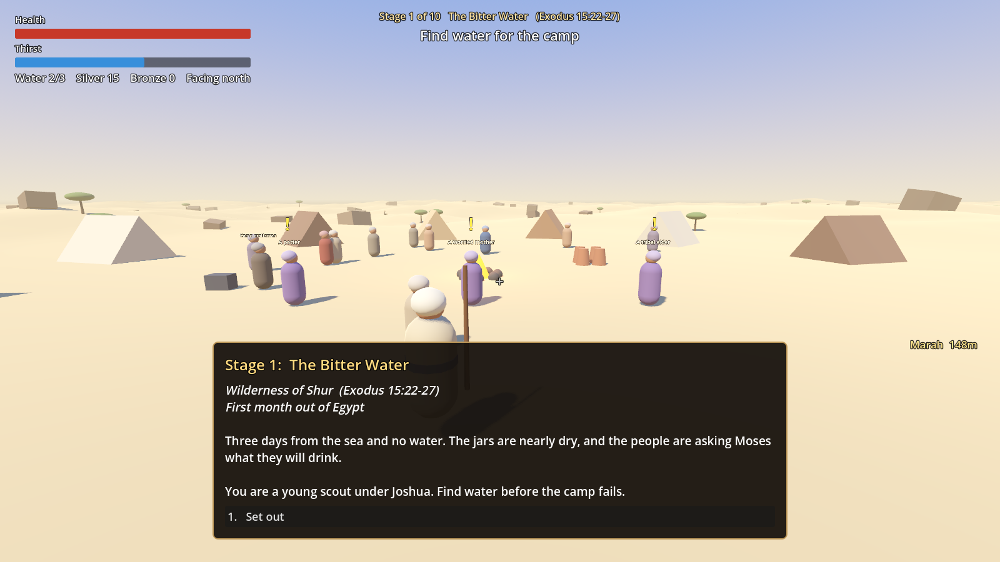

# In the Wilderness

A third-person 3D action RPG about Israel's forty years in the wilderness, from the Red Sea to
the Jordan (Exodus 15 to Deuteronomy 34). You play a young Israelite scout who keeps the camp
alive: finding water, running errands for the people, driving off raiders and following the
pillar of cloud from stage to stage.

Built with Godot 4.7 and GDScript. The people are modelled, rigged low-poly characters from
Quaternius' free CC0 kits, dressed in tunics, robes and headcloths that the game generates to
fit them. The terrain, tents and props are built in code from simple shapes. Everything needed
is in the repository, so a fresh clone is ready to run.

**Status:** playable prototype. No sound, and the numbers are not yet balanced.

A new journey starts in the character creator: sex, skin, face shape, eyes, brows, hair,
beard, head covering, clothing and colors.

The pictures in `screenshots/` were taken before the modelled characters were added and still
show the earlier placeholder figures.



## Set up a new PC

You need Git and **Godot 4.7.x, standard build** (not the .NET build). Any GPU that supports
Vulkan, Direct3D 12 or Metal is enough.

1. Install Godot and make sure `godot --version` prints `4.7.x`.

   | System | Install |
   |---|---|
   | Windows | `winget install GodotEngine.GodotEngine`, then open a new terminal. This adds `godot` (window) and `godot_console` (prints to the terminal). |
   | macOS | `brew install --cask godot` |
   | Linux | `flatpak install flathub org.godotengine.Godot`, or your distribution's package |
   | Any | Download from <https://godotengine.org/download> and put the executable on your PATH as `godot`. |

   Package managers can lag behind or run ahead. If the version is not 4.7.x, use the download page.

2. Clone and enter the project.

   ```bash
   git clone https://github.com/TurkishP/in_the_wilderness.git
   cd in_the_wilderness
   ```

3. Build the import cache once. This creates the untracked `.godot/` folder and converts the
   character models, so it can take a minute.

   ```bash
   godot --headless --path . --import
   ```

4. Confirm the setup with the self-test. On Windows use `godot_console` so the output is visible.

   ```bash
   godot --headless --path . -- --selftest
   ```

   It must print `SELFTEST OK  (0 failed)`. Read the output rather than the exit code: a script
   error stops the test early and Godot still exits with 0.

5. Play.

   ```bash
   godot --path .
   ```

   On Windows you can also double-click `play.cmd`.

## Everyday commands

| Task | Command |
|---|---|
| Play | `godot --path .` |
| Open in the Godot editor | `godot --path . --editor` |
| Self-test (no window) | `godot --headless --path . -- --selftest` |
| Start at stage N with a throwaway save | `godot --path . -- --stage=N` |
| Save a screenshot and exit | `godot --path . --resolution 1600x900 -- --stage=2 --auto --shot=/full/path/out.png` |

Everything after the bare `--` is a debug argument of the game. The full list is at the top of
[scripts/world.gd](scripts/world.gd): teleporting to the objective, starting a raid, opening a
menu, skipping objectives.

Run the self-test after every change, and take a screenshot after any visual change.

## Controls

| Key | Action |
|---|---|
| W A S D | Move |
| Mouse | Look |
| Shift | Sprint (costs thirst) |
| Space | Jump |
| Left mouse | Strike with the staff or blade |
| Right mouse | Sling a stone at the crosshair |
| E | Talk or use |
| Q | Drink from the waterskin |
| Tab | Gear |
| Esc | Pause menu, controls, and "Change how you look" |

## How the game is put together

Each stage has a camp at the centre of a 400 m wide stretch of desert. A stage is finished by
completing its main objectives in order, then walking to the pillar of cloud.

| File | What it holds |
|---|---|
| [data/stages.gd](data/stages.gd) | The ten stages: texts, scripture references, main objectives, side quests, raid settings |
| [data/items.gd](data/items.gd) | Weapons, slings and armor |
| [data/enemies.gd](data/enemies.gd) | Wildlife, raiders and bosses |
| [scripts/game.gd](scripts/game.gd) | Autoload `Game`: saved state, gear rules, save file, mesh helpers |
| [scripts/world.gd](scripts/world.gd) | Builds a stage, runs the main objectives, holds the debug arguments and the self-test |
| [scripts/quests.gd](scripts/quests.gd) | Side quests: gather items, find a lost child, investigate a wrongdoer |
| [scripts/raid_director.gd](scripts/raid_director.gd) | Raids on the camp, growing with each raid and each stage |
| [scripts/hud.gd](scripts/hud.gd) | All interface. Every menu is one `dialog()` call; the character creator is its own panel |
| [scripts/human.gd](scripts/human.gd) | The human figure used for the player, camp people and raiders: option tables, body and hair, generated clothes, weapons, animation |
| [scripts/retarget.gd](scripts/retarget.gd) | Converts the animation kit's clips to the character kit's skeleton when the game starts |
| [assets/characters/](assets/characters/) | Bodies, hair, textures and animations (CC0, see `LICENSE.txt` there) |
| [tools/prepare_characters.py](tools/prepare_characters.py) | Rebuilds `assets/characters/` from the downloaded kit. Only needed if the source kit changes |
| `scripts/player.gd`, `enemy.gd`, `npc.gd`, `projectile.gd`, `pickup.gd`, `interactable.gd`, `terrain.gd` | The things in the world |

To add or change content, edit the tables in `data/`. A new stage is one more dictionary in
`data/stages.gd`; the field list is in the comment at the top of that file. The five main
objective types are `reach`, `collect`, `boss`, `defend` and `rescue`.

### Characters

Every person is the same figure from `scripts/human.gd`, driven by a "look": a dictionary of
indices into the `OPTIONS` table at the top of that file (sex, skin, face shape, eyes, brows,
hair, hair color, beard, head covering, outfit, cloth color, sash color). The player's look is
edited in the character creator and saved with the game. Camp people and raiders get a random
look, shaped by their role.

What a figure is made of:

- **Body.** `male.gltf` or `female.gltf`, with one skin texture tinted to the chosen tone and
  the head bone scaled for the face shape.
- **Hair, beard, brows.** Separate meshes hung on the head bone. Each was modelled on one of
  the two bodies; on the other body it is moved and scaled to that head automatically.
- **Clothes.** Generated in code and skinned to the same skeleton, so they bend with the body.
  Close-fitting pieces (tunic top, sleeves, vest, cap, shoes) are copies of part of the body
  mesh pushed outward. Loose pieces (skirt, sash, cloak) are tubes and sheets sized from
  cross-sections of the body, with the lower rows following the leg bones. Everything is
  measured from the mesh, so one piece of code fits both bodies.
- **Animation.** The clips in `animations.glb` are made for a different skeleton.
  `scripts/retarget.gd` converts the ones the game uses to each body when the first figure is
  built (about a tenth of a second). Walking blends idle, walk, jog and sprint by speed; a
  strike or a sling throw plays on the upper body only, so the legs keep moving.
- **Weapon.** The equipped melee weapon hangs from the right hand. It is carried in a resting
  position and turned into the fist for a blow.

To add an appearance choice, append a name to the matching list in `OPTIONS` and handle the new
index in `build()`, `_dress()` or `_make_piece()`. The creator picks it up by itself. A new
clothing piece is one more case in `_make_piece()`, built with `_shell()` (fitted) or with
`_ring()`, `_skirt()` or `_cloak()` (loose).

Limits of the free kits: one build per sex, four hairstyles, one beard, and no face shapes
beyond scaling the head. The paid "Source" versions of the kits add more bodies and hair.

## Conventions

- Scenes are built in code. `scenes/main.tscn` only attaches `world.gd`.
- Commit the `*.gd.uid` files next to each script. Never commit `.godot/`.
- In `hud.dialog()` the last option must be the safe one (leave, close), because Esc picks it.
- `world` is an untyped variable in most scripts, so give explicit types to values read through
  it (`var p: Vector3 = world.ground(x, z)`). With `:=` the script fails to compile.
- North is -Z and east is +X. The camp is at the origin and the ground is flat within 30 m of it.
- Every rule that matters gets a check in `_selftest()` at the bottom of `scripts/world.gd`.

## Handling the source text

- Main objectives follow events in Exodus, Numbers and Deuteronomy, and each stage shows its
  reference. Read the passage before writing or changing stage text.
- The player witnesses miracles and never triggers them.
- Side quests, raids outside the recorded battles, and all side characters are invented.
  Invented characters have role names only ("a potter"), and biblical figures are given no
  invented lines.

## Credits and licences

Character bodies, hair, textures and animations are from Quaternius' Universal Base Characters
and Universal Animation Library (Standard versions), released under CC0 1.0. Details and the
list of changes are in [assets/characters/LICENSE.txt](assets/characters/LICENSE.txt).

## Save files

Progress is saved at the start of each stage as `save.json` in Godot's user data folder:

| System | Folder |
|---|---|
| Windows | `%APPDATA%\Godot\app_userdata\In the Wilderness\` |
| macOS | `~/Library/Application Support/Godot/app_userdata/In the Wilderness/` |
| Linux | `~/.local/share/godot/app_userdata/In the Wilderness/` |

Delete the file, or choose "Start a new journey" in the pause menu, to begin again. Runs started
with `--stage=N` or `--selftest` write to separate files and leave the real save alone.

## Not done yet

- Sound and music.
- Clothing is simple: plain colors, no textures or folds. Armor does not show on the figure;
  only the melee weapon in the hand changes with gear.
- Terrain, tents and props are still simple shapes. Animals are still built from boxes.
- New screenshots. The current ones predate the modelled characters.
- Balance. Damage, prices and timings are first guesses and have not been tuned by play.
- Stages 2 to 10 reuse the stage-1 building blocks with different data and need hand tuning.
