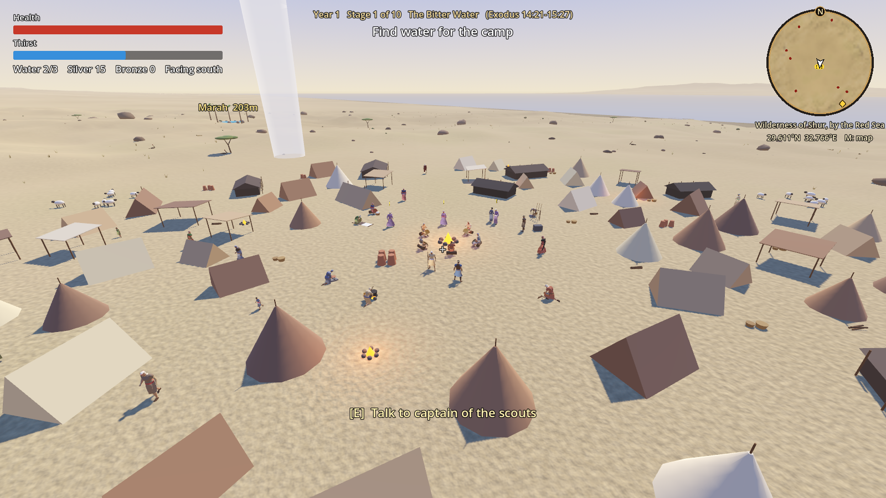
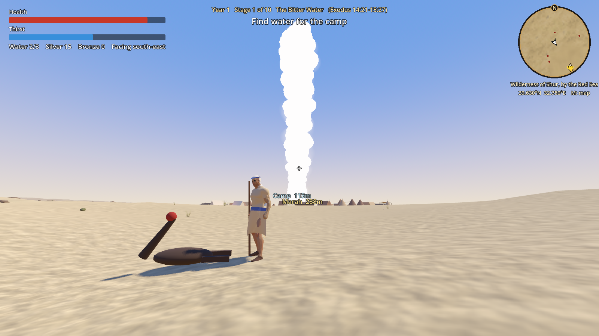

# In the Wilderness

A third-person 3D action RPG about Israel's forty years in the wilderness, from the Red Sea to
the Jordan (Exodus 15 to Deuteronomy 34). You play a young Israelite scout who keeps the camp
alive: finding water, running errands for the people, driving off raiders and following the
pillar of cloud from stage to stage.

Built with Godot 4.7 and GDScript. The people are modelled, rigged low-poly characters from
Quaternius' free CC0 kits, dressed in tunics, robes and headcloths that the game generates to
fit them. Each stage's land is shaped from a model of the real region, so the sea and the
mountains stand where they do at that camp, and it is strewn with rocks, dry grass, bushes and
acacias. The camp is a close-packed spread of tents where men, women and children walk about,
sit by the fire and work, and will tell you what is on their minds; from Sinai onward the
tabernacle stands at its centre. A round map in the corner shows your surroundings and
position, and M opens a map of the whole journey. Everything needed is in the repository, so a
fresh clone is ready to run.

**Status:** playable prototype. No sound, and the numbers are not yet balanced.

A new journey starts in the character creator: sex, skin, face shape, eyes, brows, hair,
beard, head covering, clothing and colors.



## Set up a new PC

You need Git and **Godot 4.7.x, standard build** (not the .NET build). Any GPU that supports
Vulkan, Direct3D 12 or Metal is enough.

1. Install Godot and make sure `godot --version` prints `4.7.x`.

   | System | Install |
   |---|---|
   | Windows | `winget install GodotEngine.GodotEngine`, then open a new terminal. This adds `godot` (window) and `godot_console` (prints to the terminal). |
   | macOS | `brew install --cask godot` |
   | Linux | `flatpak install flathub org.godotengine.Godot`, or your distribution's package |
   | Any | Download from <https://godotengine.org/download> and put the executable on your PATH as `godot`. |

   Package managers can lag behind or run ahead. If the version is not 4.7.x, use the download page.

2. Clone and enter the project.

   ```bash
   git clone https://github.com/TurkishP/in_the_wilderness.git
   cd in_the_wilderness
   ```

3. Build the import cache once. This creates the untracked `.godot/` folder and converts the
   character models, so it can take a minute.

   ```bash
   godot --headless --path . --import
   ```

4. Confirm the setup with the self-test. On Windows use `godot_console` so the output is visible.

   ```bash
   godot --headless --path . -- --selftest
   ```

   It must print `SELFTEST OK  (0 failed)`. Read the output rather than the exit code: a script
   error stops the test early and Godot still exits with 0.

5. Play.

   ```bash
   godot --path .
   ```

   On Windows you can also double-click `play.cmd`.

## Everyday commands

| Task | Command |
|---|---|
| Play | `godot --path .` |
| Open in the Godot editor | `godot --path . --editor` |
| Self-test (no window) | `godot --headless --path . -- --selftest` |
| Start at stage N with a throwaway save | `godot --path . -- --stage=N` |
| Save a screenshot and exit | `godot --path . --resolution 1600x900 -- --stage=2 --auto --shot=/full/path/out.png` |

Everything after the bare `--` is a debug argument of the game. The full list is at the top of
[scripts/world.gd](scripts/world.gd): teleporting to the objective, starting a raid, opening a
menu (`--menu=gear|trade|chest|lid|settings`), equipping gear (`--equip=bronze_spear,hide_shield`),
holding the sling or bow for a screenshot (`--aim=sling|bow`), stopping in the middle of a blow
(`--blow=3 --view=115`), skipping objectives.

The music is made by [tools/make_music.py](tools/make_music.py) (needs Python with numpy, and
ffmpeg). Run it again only to change the music; the `.ogg` files it writes are committed.

Run the self-test after every change, and take a screenshot after any visual change.

## Controls

| Key | Action |
|---|---|
| W A S D | Move |
| Mouse | Look |
| Shift | Sprint (costs thirst and stamina; walk to get your breath back) |
| Space | Jump |
| Left mouse | Strike. Press again during a blow for the next one: a cut from top to bottom, a sweep from left to right, then a cut from top right to bottom left. With a blade in each hand the sweep is the left hand's. Heavier weapons swing more slowly. In the air the first blow is a jump attack, brought down from overhead. With a bow: hold to draw, release to shoot |
| Right mouse | Hold to whirl the sling, release to throw. While it goes round, a dotted arc and a ring show where the stone will land (red on an enemy). Each throw uses up a stone |
| R | Put both hands' gear away (staff, spear, bow and shield on the back, blades at the belt) or take it up. Attacking takes it up by itself |
| E | Talk or use |
| Q | Drink from the waterskin |
| I (or Tab) | Inventory: the bag on the left, what you wear and wield on the right |
| M | Map of the journey |
| Esc | Pause menu: controls, settings, "Change how you look" |

### Carrying, water and saving

- **Bag:** a grid of places, and bigger things take more of them: a dagger 1x2, a sword 1x3, a
  spear or staff 1x4, a shield 2x2 or 2x3, a robe 2x4. Sling stones stack five to a place and
  arrows twenty. The belt pouch is 6x4; the trader sells a shoulder bag (8x5) and a traveller's
  pack (10x6), and stones and arrows by the handful. Stones are also gathered with E from stony
  patches out in the wilderness. Gear lying on the ground stays there while the bag has no room.
- **Inventory (I):** click an item to pick it up and click again to put it down, on a free place,
  on another item to swap them, or on a slot to wear it. Right-click equips, or takes off into
  the bag. Hovering shows what an item does. Slots: head, neck, right hand, left hand, upper
  body, belt, lower body, sling. Either hand takes a weapon or a shield, so two swords can be
  wielded; a bow takes both hands; a robe or dress takes the place of top and bottom. What is
  worn shows on the figure.
- **Stats:** each item may give damage, defense, health, thirst regen (thirst won back per
  second, against the heat) and stamina regen, and has a weight. Defense stops a share of each
  blow (40 defense stops half). A weapon's weight sets its swing speed: about 1.5 kg swings at
  normal speed, a dagger much faster, a mace or axe slower. Gear comes in six tiers, from flint
  and wood to iron and the rare finds; the trader sells the current stage's tier and the one
  before.
- **Trader:** the goods are laid out beside your bag. Click to buy; right-click your own things
  to sell, or drop them on the trader's side.
- **Water:** besides the jars by the fire, wooden barrels (fill the waterskin) and tables with
  a jug and cups (a drink on the spot) stand about the camp. They are dry until the camp has
  water, as at the first stage before Marah.
- **Your tent** stands at the edge of the gathering ground, marked with a pennant. Inside are
  a bed, a chest (14x10 places, kept for the whole journey; its lid swings open while it is in
  use, with the bag beside it on screen) and a water jar. Sleeping in
  the bed restores health and saves the game, and this is the only way to save: loading wakes
  you there with the stage's objectives as they were. If you fall, you are carried back to it.

## How the game is put together

Each stage has a camp at the centre of about 400 m of walkable ground, set in a 5 km backdrop
of that place's real mountains and seas. A stage is finished by completing its main objectives
in order, then walking to the pillar of cloud.

| File | What it holds |
|---|---|
| [data/stages.gd](data/stages.gd) | The ten stages: texts, scripture references, main objectives, side quests, raid settings |
| [data/items.gd](data/items.gd) | Everything that can be carried, worn or wielded: slot, size in the bag, weight, stats, tier, price, how it looks when worn; the bag sizes |
| [data/enemies.gd](data/enemies.gd) | Wildlife, raiders and bosses |
| [data/region.gd](data/region.gd) | A coarse model of the Sinai, the Negev, Edom and Moab: mountain masses, ranges, the rift valley, coastlines |
| [data/talk.gd](data/talk.gd) | What ordinary people in the camp say, stage by stage, with the passage each group of lines draws on |
| [scripts/game.gd](scripts/game.gd) | Autoload `Game`: saved state, the bag and chest grids, equipment and stats, save file, settings, music, mesh helpers |
| [scripts/world.gd](scripts/world.gd) | Builds a stage, runs the main objectives, holds the debug arguments and the self-test |
| [scripts/quests.gd](scripts/quests.gd) | Side quests: gather items, find a lost child, investigate a wrongdoer |
| [scripts/raid_director.gd](scripts/raid_director.gd) | Raids on the camp, growing with each raid and each stage |
| [scripts/hud.gd](scripts/hud.gd) | All interface. Most menus are one `dialog()` call; the character creator and the settings page are panels of their own |
| [scripts/inventory_ui.gd](scripts/inventory_ui.gd) | The inventory, chest and trader screens: grids, equipment slots, item pictures and tooltips |
| [scripts/human.gd](scripts/human.gd) | The human figure used for the player, camp people and raiders: option tables, body and hair, generated clothes, weapons, animation |
| [scripts/retarget.gd](scripts/retarget.gd) | Converts the animation kit's clips to the character kit's skeleton when the game starts |
| [scripts/terrain.gd](scripts/terrain.gd) | One stage's land: detailed ground, far backdrop and water, all taken from the region model |
| [scripts/scenery.gd](scripts/scenery.gd) | Rocks, dry grass, bushes and acacias, drawn in batches |
| [scripts/camp.gd](scripts/camp.gd) | The camp: tents, cooking fires, flocks, the tabernacle, places for people to sit and work, water barrels and cups, the scout's own tent, and the paths they walk |
| [scripts/home.gd](scripts/home.gd) | The inside of the scout's own tent: bed (the only place the game is saved), chest, water jar |
| [scripts/creature.gd](scripts/creature.gd) | The animals (viper, scorpion, jackal): low-poly models built and animated in code |
| [scripts/minimap.gd](scripts/minimap.gd) | The round map in the corner |
| [scripts/region_map.gd](scripts/region_map.gd) | The map of the whole journey (M) |
| [assets/characters/](assets/characters/) | Bodies, hair, textures and animations (CC0, see `LICENSE.txt` there) |
| [tools/prepare_characters.py](tools/prepare_characters.py) | Rebuilds `assets/characters/` from the downloaded kit. Only needed if the source kit changes |
| [tools/make_music.py](tools/make_music.py) | Synthesises the background music into `assets/music/` |
| `scripts/player.gd`, `enemy.gd`, `npc.gd`, `projectile.gd`, `pickup.gd`, `interactable.gd` | The things in the world |

To add or change content, edit the tables in `data/`. A new stage is one more dictionary in
`data/stages.gd`; the field list is in the comment at the top of that file. The five main
objective types are `reach`, `collect`, `boss`, `defend` and `rescue`.

### The camp

`scripts/camp.gd` lays out the camp afresh for each stage.

- **Tents:** sixty or more, of five kinds (small ridge tents, long low tents of dark goat
  hair, round tents, open shelters on poles, large family tents), in varied sizes, packed as
  close as 1.4 m. The gathering ground and the ways in are kept clear.
- **The pillar of cloud:** in the first two stages there is no tabernacle yet. It was set up
  at Sinai on the first day of the first month of the second year (Exodus 40:17). Until then
  the pillar of cloud stands at the edge of the camp on the side of the way ahead
  (Exodus 13:21-22), and moves on when the stage is finished. The pillar
  (`scripts/cloud_pillar.gd`) is a slowly turning column of a few hundred soft white billows
  under a faint haze; the same thing stands over the tabernacle and marks the way out of a
  finished stage.

  
- **Gathering ground:** the main fire, the trader, the craftsman, the captain and the people
  with errands. Before Sinai it is the middle of the camp. Once the tabernacle stands it lies
  just south of the court.
- **The tabernacle:** built to the measures in Exodus 26-27 and 38 at full size (a cubit taken
  as 0.457 m): a court of 100 by 50 cubits on sixty posts hung with linen, the gate with its
  blue, purple and scarlet screen on the east, the tent of 30 by 10 by 10 cubits in the western
  half, the bronze altar with its fire and the basin before it, and the cloud over the tent.
  At Sinai the ground is only marked out; the tabernacle is raised when the stage's objective
  (acacia wood for its frames) is done. From Paran on it stands from the start, and its cloud
  lifts when the stage is finished. The linen is solid; the gate screen can be walked through.
- **People:** five sit on logs round the main fire, and six are at work round the gathering
  ground (weaving at a ground loom, spinning, grinding, cooking, sharpening weapons, mending
  rope). Twelve more, men, women and children, walk the camp along paths that keep them out of
  the tents and the court.

Anyone can be spoken to. Their lines are in `data/talk.gd`: for each stage, things anyone might
say and things a man, a woman or a child might say, plus lines about the work a person is doing
and a few that fit any day. Each person says everything once, in a random order, before
repeating. To add a line, append it to the right list; the comment beside each stage names the
passage its lines draw on.

### The land

`data/region.gd` is a hand-built model of the country between Egypt and the Jordan. Mountain
masses are smooth bumps (the southern Sinai massif, Jebel Musa, Jebel Serbal, the et-Tih
plateau, the Negev highlands), ranges are ridges along a line (Edom, Moab, Midian, the Judean
hills), the Arabah and the Jordan valley are a trough, and each sea is a short outline with a
water level. It is built from well-known coordinates and heights, not from survey data, and is
right to roughly ten kilometres and a few hundred metres of height. The comment at the top of
the file lists what it contains.

Each stage has a `site`: the latitude and longitude of its camp. The sites follow traditional
identifications (Ain Hawarah for Marah, Jebel Musa for Sinai, Tell el-Qudeirat for Kadesh, and
so on); several are debated, and the map screen says so. `scripts/terrain.gd` reads the model
around the site at 25 real metres to one game metre, with heights raised by half:

- **Ground:** 600 m square with dunes and collision, level at the camp.
- **Backdrop:** 5 km square (125 km on the real map), without collision.
- **Water:** every sea within the backdrop, at its own level. The Dead Sea lies far below Moab.

So at the first camp, two days' march from the crossing, the Gulf of Suez lies close by to the
west; at Sinai a mountain stands south-east of the camp, near Elath the Gulf of Aqaba lies to the south, and from the plateau of Moab the Dead
Sea is below. The self-test checks each of these.

The ground is colored point by point (sand tones, dry-grass patches, bare rock on slopes) under
a fine grain texture. `scripts/scenery.gd` scatters the plants and stones; a stage's `veg`
numbers say how much grass, bush, tree and rock grows there.

The corner map is a top-down picture of the ground, lit from the north-west, with the player at
the centre and north up. It marks the camp, the objective, people who need help, things to
collect, wildlife and raiders; marks beyond its edge sit on the rim. Under it are the place name
and the position as it would read on a real map.

To move a camp, change its `site`. To reshape the country, edit the tables in `data/region.gd`
and compare `Region.elevation()` with known heights (the self-test has examples).

### Characters

Every person is the same figure from `scripts/human.gd`, driven by a "look": a dictionary of
indices into the `OPTIONS` table at the top of that file (sex, skin, face shape, eyes, brows,
hair, hair color, beard, head covering, outfit, cloth color, sash color). The player's look is
edited in the character creator and saved with the game. Camp people and raiders get a random
look, shaped by their role.

What a figure is made of:

- **Body.** `male.gltf` or `female.gltf`, with one skin texture tinted to the chosen tone and
  the head bone scaled for the face shape.
- **Hair, beard, brows.** Separate meshes hung on the head bone. Each was modelled on one of
  the two bodies; on the other body it is moved and scaled to that head automatically.
- **Clothes.** Generated in code and skinned to the same skeleton, so they bend with the body.
  Close-fitting pieces (tunic top, sleeves, vest, cap, shoes) are copies of part of the body
  mesh pushed outward. Loose pieces (skirt, sash, cloak) are tubes and sheets sized from
  cross-sections of the body, with the lower rows following the leg bones. Everything is
  measured from the mesh, so one piece of code fits both bodies.
- **Animation.** The clips in `animations.glb` are made for a different skeleton.
  `scripts/retarget.gd` converts the ones the game uses to each body when the first figure is
  built (about a tenth of a second). Walking blends idle, walk, jog and sprint by speed; a
  strike or a sling throw plays on the upper body only, so the legs keep moving. A blow made
  standing still also plays on the hips and legs: the hips turn and drive forward, the knees
  bend and the feet stay planted. Off the ground the body goes over to the kit's `Jump` pose,
  and a figure that lands standing still sinks on its knees for a moment (`Land`).
- **Weapons.** Each hand can hold something: a weapon in the fist, a shield strapped to the
  forearm, or (left hand) a bow. It is carried in a resting position and turned into the fist
  for a blow. The three blows, the sling and the bow are not clips from the kit: they are made
  by aiming the arm bones and turning the forearm and wrist so the blade points along the cut
  (`_blow_keys()`, `_aimed()` and `_grip()`). Left-hand blows are the right-hand ones mirrored.
  Each blow pose also says how the hips turn, shift and sink; `_stand()` then bends the legs so
  the feet stay where they are (the left foot is in front, as in the Idle clip). The jump
  attack (`Blow_Air_R/L`) gives each thigh and shin a direction instead, since nothing holds
  the feet: the legs trail as the weapon goes up and the knees come forward as it comes down.
- **Clothes from gear.** For the player, what is equipped decides the clothes (the `wear` list
  of each item in `data/items.gd`): a tunic, a robe, a scale coat, a helmet, a necklace. Cloth
  and sash colors still come from the character creator; the creator's clothing row is not shown
  for the player.

To add an appearance choice, append a name to the matching list in `OPTIONS` and handle the new
index in `build()`, `_dress()` or `_make_piece()`. The creator picks it up by itself. A new
clothing piece is one more case in `_make_piece()`, built with `_shell()` (fitted) or with
`_ring()`, `_skirt()` or `_cloak()` (loose).

Limits of the free kits: one build per sex, four hairstyles, one beard, and no face shapes
beyond scaling the head. The paid "Source" versions of the kits add more bodies and hair.

## Conventions

- Scenes are built in code. `scenes/main.tscn` only attaches `world.gd`.
- Commit the `*.gd.uid` files next to each script. Never commit `.godot/`.
- In `hud.dialog()` the last option must be the safe one (leave, close), because Esc picks it.
- `world` is an untyped variable in most scripts, so give explicit types to values read through
  it (`var p: Vector3 = world.ground(x, z)`). With `:=` the script fails to compile.
- North is -Z and east is +X. The camp is at the origin and the ground is flat within 30 m of it.
- Every rule that matters gets a check in `_selftest()` at the bottom of `scripts/world.gd`.

## Handling the source text

- Main objectives follow events in Exodus, Numbers and Deuteronomy, and each stage shows its
  reference. Read the passage before writing or changing stage text.
- The player witnesses miracles and never triggers them.
- Side quests, raids outside the recorded battles, and all side characters are invented.
  Invented characters have role names only ("a potter"), and biblical figures are given no
  invented lines.
- What villagers say is invented, but what they refer to must be in the passage for that stage.
  Where a line reports what a biblical figure said or did, it follows the text.

## Credits and licences

Character bodies, hair, textures and animations are from Quaternius' Universal Base Characters
and Universal Animation Library (Standard versions), released under CC0 1.0. Details and the
list of changes are in [assets/characters/LICENSE.txt](assets/characters/LICENSE.txt).

The music (two pieces, in maqam Hijaz and maqam Bayati, for a plucked oud-like string, a ney
flute, a drone and a frame drum) is synthesised by `tools/make_music.py` and is the project's
own.

## Save files

Progress is saved only when you sleep in your own tent, as `save.json` in Godot's user data folder:

| System | Folder |
|---|---|
| Windows | `%APPDATA%\Godot\app_userdata\In the Wilderness\` |
| macOS | `~/Library/Application Support/Godot/app_userdata/In the Wilderness/` |
| Linux | `~/.local/share/godot/app_userdata/In the Wilderness/` |

Delete the file, or choose "Start a new journey" in the pause menu, to begin again. Runs started
with `--stage=N` or `--selftest` write to separate files and leave the real save alone. Saves
from before the bag had places still load: the gear is laid out in the bag and the chest.

Settings (volume, mouse, field of view, screen) are kept in `settings.cfg` in the same folder.

## Not done yet

- Sound effects. There is music, but no other sound yet.
- Clothing is simple: plain colors, no textures or folds.
- Shields do not block; they add defense.
- The land is a coarse model, not survey data. Water is a flat sheet. Tents and camp props are
  still simple shapes, and animals are still built from boxes.
- Balance. Damage, prices and timings are first guesses and have not been tuned by play.
- Stages 2 to 10 reuse the stage-1 building blocks with different data and need hand tuning.
